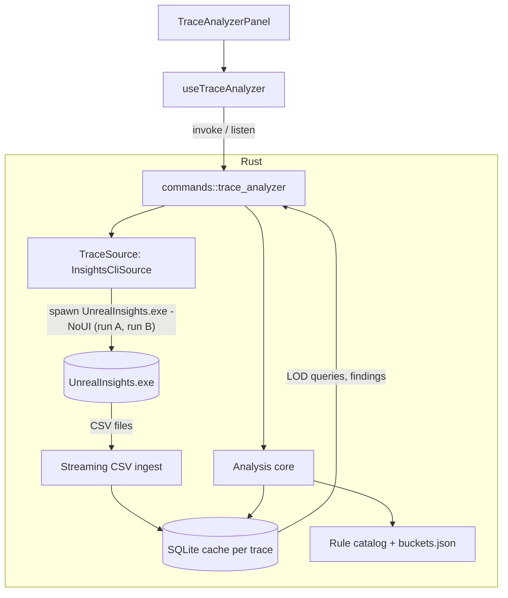

# Trace Analyzer — ToolBox tool specification

A new ToolBox tool for UE Launcher (CommandHelper) that opens an Unreal `.utrace` capture, shows a **frame time graph**, and tells the developer **what is most likely wrong with the slow frames and how likely the suggested fix is to work**.

Audience: a coding agent implementing this in the existing repo. Read sections 0–2 first, then do the **spike in section 13 before writing any UI**.

---

## 0. Priorities (in order)

1. **Diagnosis quality.** The product is the sentence "this is probably what's wrong, this is the usual fix, this is how likely it is to help". The graph supports it, it is not the point.
2. **Large traces must not hurt.** Traces reach multiple GB. Loading must be streamed, cancellable, cached and never freeze the UI or blow up memory.
3. **Fit the existing app.** Same stack, same patterns, same dark minimal look. No new frameworks.
4. **Honesty.** The tool must say when it does not know. A wrong confident answer is worse than "inconclusive".

### Guardrails (explicit non-goals for the MVP)

- Do **not** rebuild a timeline viewer. Unreal Insights already does that. We produce a *report* plus a graph.
- Do **not** write a native `.utrace` binary parser in the MVP (see section 5.4 for why and for the escape hatch).
- Do **not** add a charting library. Draw the graph on `<canvas>` (the Log Analyzer already does this for its minimap).
- No network access, no telemetry, no cloud. Everything is local.
- No LLM calls. Findings come from a deterministic rule catalog (section 8).

---

## 1. Summary of the feature

User drops a `.utrace` file onto the tool (or picks one). The app:

1. Runs the engine's own `UnrealInsights.exe` headlessly to export compact data (CSV).
2. Streams that data into a local SQLite cache.
3. Shows the **frame time graph** as soon as frame data is available.
4. Detects **hitches** (isolated spikes) and **slow regions** (sustained load) separately.
5. Compares slow frames against **nearby normal frames** to find what is abnormal.
6. Matches the result against a **catalog of known causes** and shows ranked **Findings**, each with evidence, usual fixes, a fix-likelihood rating and a way to verify.

Example file for testing: "C:\Users\hp\AppData\Local\UnrealEngine\Common\UnrealTrace\Store\001\20261027_102636.utrace"
---

## 2. Context: the existing repo (verified by reading it)

Repository: `Ciji-Games/UE_Launcher_CommandHelper`. Windows-only Tauri app.

| Area | Facts to follow |
|---|---|
| Frontend | React **19**, TypeScript ~5.9 (`strict`, `noUnusedLocals`, `verbatimModuleSyntax`, `erasableSyntaxOnly`), Vite 7, Tailwind **4**, `react-icons`. `package.json` is the source of truth (older `.junie` plans say React 18, ignore that). |
| Backend | Rust, Tauri 2. Already depends on `rusqlite` (bundled), `regex`, `walkdir`, `tokio`, `serde`, `zip`, `sysinfo`, `windows`. |
| Tauri plugins | dialog, store, opener, shell, notification, updater, process, autostart. |
| Tool registration | `src/components/ToolBoxTab.tsx` has a `TOOLS` array (`id`, `label`, `panel`, `contentOverflow`) and a `ToolIcon` SVG-path map. Adding a tool = add an entry + an icon path. Tools needing the full height use `contentOverflow: 'hidden'` (Log Analyzer, Include finder). |
| Command registration | `src-tauri/src/commands/mod.rs` (`pub mod ...`) and `src-tauri/src/lib.rs` (`tauri::generate_handler![...]`). Commands are `snake_case`, namespaced like `commands::include_finder::search_includes`. |
| Long work pattern | `include_finder.rs`: `#[tauri::command] pub async fn`, work inside `tokio::task::spawn_blocking`, progress via `app.emit("include-finder:progress", payload)`. Mirror this. |
| SQLite pattern | `include_finder.rs` stores DBs under `app.path().app_data_dir()` (`get_db_dir`, per-engine and per-project DB files). Mirror this for the trace cache. |
| Process spawning | `utils::build_cmd`, `stream_processor::process_streams` / `emit_log` (streams stdout/stderr into the ToolBox **Output Log** and parses progress), `running_process::set_running_pid/clear_running_pid` (Stop button kills the tree), `CREATE_NO_WINDOW` flag `0x0800_0000`. Reuse them to run `UnrealInsights.exe`. Note `running_process` tracks **one** PID globally. |
| Frontend progress | `ProgressContext` (`startProgress`, `finishProgress`), `LogContext` / `OutputLogPanel`. Tools call `startProgress()` before `invoke` and `finishProgress()` in `finally`. |
| Project / engine data | `useProjects`, `useEngines`, `getShortEngineVersion`; `useIncludeFinder` shows how a project resolves to an engine root and version. Engine root is the folder containing `Engine/`. |
| Settings storage | `useSettings` / `SettingsContext` / `useStore` (tauri-plugin-store). |
| Closest analogues to copy from | `UELogAnalyzerPanel.tsx` (file drop via `onDragDropEvent`, canvas minimap, virtualized fixed-row-height list `IH = 18`, `ResizeObserver`), `IncludeModuleFinderPanel.tsx` + `useIncludeFinder.ts` + `types/includeFinder.ts` (hook + types + panel split, scan progress, SQLite-backed search). |
| **Do NOT reuse** | `commands::files::read_text_file`. It reads the entire file into a `String`. Fine for logs, unacceptable for traces. |
| Styling | Dark slate palette (`bg-slate-800/30`, `border-slate-600/60`, active `bg-sky-600/60 text-sky-100`, text `slate-300/400`), CSS variables in `src/index.css`. Window opens maximized, `dragDropEnabled: true`. |
| Quality gates | `npm run lint`, `npm run build` (runs `tsc -b`), and `cargo check` in `src-tauri`. Husky pre-commit only bumps versions on the `release` branch. |
| Docs | `docs/TOOLBOX.md` documents each tool; README has a features table. Update both when done. |

### Naming and file layout to create

```
src-tauri/src/commands/trace_analyzer.rs      # thin Tauri command layer (like include_finder.rs)
src-tauri/src/trace/mod.rs
src-tauri/src/trace/insights_cli.rs           # locate exe, build .rsp files, run, cancel
src-tauri/src/trace/csv_ingest.rs             # streaming, header-driven CSV -> SQLite
src-tauri/src/trace/store.rs                  # SQLite schema, cache keys, LOD queries
src-tauri/src/trace/frames.rs                 # frame table, stats, hitch + slow-region detection
src-tauri/src/trace/exclusive.rs              # nesting + exclusive-time computation
src-tauri/src/trace/buckets.rs                # timer name -> bucket / kind (work|wait|idle|editor_only)
src-tauri/src/trace/baseline.rs               # local + global baselines
src-tauri/src/trace/rules.rs                  # rule loading, matching, scoring
src-tauri/src/trace/source.rs                 # TraceSource trait (see 5.4)
src-tauri/resources/trace/buckets.json        # embedded with include_str!
src-tauri/resources/trace/rules/*.json        # embedded with include_str!

src/types/traceAnalyzer.ts
src/hooks/useTraceAnalyzer.ts
src/components/TraceAnalyzerPanel.tsx
src/components/traceAnalyzer/FrameGraph.tsx   # canvas
src/components/traceAnalyzer/SummaryHeader.tsx
src/components/traceAnalyzer/FindingCard.tsx
src/components/traceAnalyzer/EpisodeDetail.tsx
src/components/traceAnalyzer/LoadingStages.tsx
docs/TRACE_ANALYZER.md                        # user doc + "verified CLI behavior" from the spike
```

Add `mod trace;` in `lib.rs`. Add `csv = "1"` and a stable hash crate (`blake3 = "1"`) to `Cargo.toml`. **No new npm dependencies.**

---

## 3. User experience

### 3.1 Placement
New ToolBox entry **"Trace Analyzer"** (`id: 'trace-analyzer'`, `contentOverflow: 'hidden'`), after "UE Log Analyzer". Icon: reuse the style of the existing `log-analyzer` icon path (chart line) or a variant.

### 3.2 Layout (dark, minimal, matches other panels)

```
┌ Toolbar ──────────────────────────────────────────────────────────────────────┐
│ [Open trace…] [Recent ▾]  Engine: [5.7.x ▾]  Target: [60 fps ▾]   ⟲ status    │
├ Summary ──────────────────────────────────────────────────────────────────────┤
│ 1,512 frames · 9m 52s · median 60 fps · p95 41 ms · p99 98 ms · 1 hitch ·     │
│ 1 slow region · "Mostly GPU-bound from 9m10s; one CPU hitch at 8m41s (98 ms)" │
├ Frame graph (canvas) ─────────────────────────────────────────────────────────┤
│ bars/line per frame, budget lines 16.7/33.3/66.7 ms, hitch markers, range sel │
├ Findings (left, ranked) ───────────────┬ Selected episode detail (right) ─────┤
│ ● Likely: Garbage collection  ▮▮▮▯      │ bound by: Game thread                │
│   Fix likelihood: High                  │ hitch vs baseline stacked bar by      │
│ ● Likely: Sync asset load     ▮▮▯▯      │ bucket, top timers with excess ms,    │
│ …                                       │ thread breakdown, [Open in Insights] │
└─────────────────────────────────────────┴──────────────────────────────────────┘
```

- Empty state: drop zone + what is needed (engine with `UnrealInsights.exe`, which trace channels to enable, see 11.3).
- The **graph appears first** (after pass A, section 5.2). Findings arrive after pass B. Show per-stage status in `LoadingStages`.
- Keyboard: `←`/`→` jump between hitch episodes, `Esc` clears selection, mouse wheel zooms the graph, drag pans, shift-drag selects a range.
- "Copy report" button: Markdown summary of the findings (for notes or for pasting into a chat with an agent).
- "Open in Unreal Insights" button: launches `UnrealInsights.exe -OpenTraceFile="<trace>"` (GUI) as an escape hatch, and shows the episode time range (`9m 14.7s`) so the user can jump there manually.

### 3.3 Finding card (the core UI element)

Each card shows, in this order:

1. **Title** in plain language: "Likely cause: garbage collection".
2. **Match confidence** (High / Medium / Low, plus a small bar) = how sure we are the pattern is present in *this* trace.
3. **Fix likelihood** (High / Medium / Low) = how often the standard fix resolves this class of problem. Wording: High = "Usually fixes it", Medium = "Often helps", Low = "Worth trying, may not be enough". See section 8.6 for why this is not a percentage.
4. **What we saw**: 2–4 evidence bullets with numbers ("`CollectGarbage` took 71 ms, normally 0 ms; accounts for ~72 of the +85 ms over baseline; recurs every ~61 s").
5. **What to try**: ordered list, cheapest/most likely first, each with effort tag (Low/Med/High).
6. **How to verify**: what to re-capture and which number should drop.
7. **Caveats**: e.g. "Editor-only cost; will not exist in a packaged build".
8. Where it applies: list of episodes, click to select them in the graph.

Inconclusive result is a first-class finding: "Not enough information. The game thread was not running Unreal code for 48 ms (no scopes active)." with the likely non-Unreal causes (section 8.7, rule R19).

---

## 4. Architecture



Key separation: **ingestion adapter** (how data gets out of the trace) is isolated behind a `TraceSource` trait. The **analysis core** only reads SQLite. This is what makes a native parser possible later without touching the diagnosis logic.

---

## 5. Loading strategy (large traces)

### 5.1 Principles

- The app process **never reads the `.utrace` itself** in the MVP. `UnrealInsights.exe` does, in a child process. Memory use of our process stays low regardless of trace size.
- Everything we read afterwards is **streamed**: row-at-a-time CSV, batched SQLite transactions, no `Vec` of all events.
- The UI **never receives raw events**. It asks for down-sampled series and small per-episode payloads.
- Work happens in `spawn_blocking`. One analysis at a time. Cancellable.
- Results are **cached**. Re-opening the same trace is instant.

### 5.2 Two-pass export (minimizing Insights runs)

**Every `UnrealInsights.exe` invocation re-analyzes the whole trace**, which can take from seconds to minutes on a multi-GB file. So the design uses **exactly two invocations** (plus an optional third for counters in a later phase), each running **many export commands from one response file**.

Verified from Epic documentation and forum reports (UE 5.6/5.7 era):

- Command shape: `UnrealInsights.exe -OpenTraceFile=<trace> -NoUI -AutoQuit -log -ExecOnAnalysisCompleteCmd="@=<file.rsp>"`.
- Export console commands: `TimingInsights.ExportThreads`, `TimingInsights.ExportTimers` (the doc page spells it `ExporTimers`, a known typo), `TimingInsights.ExportTimingEvents` (filters by thread, timer, and time range; the forum example shows `-threads=`, `-timers=`, `-region=`), `TimingInsights.ExportTimerStatistics` (aggregated per region), and `TimingInsights.ExportCounterValues` (one 5.6.1 report of an empty CSV, so treat counters as optional).
- **Paths with spaces break an inline command**; putting the commands in an `.rsp` file and passing `@=` avoids it (confirmed by a forum poster). Always use an `.rsp`.
- Output may be `.csv` or `.tsv`.

**Pass A (cheap, always):**
```
TimingInsights.ExportThreads  "<work>/threads.csv"
TimingInsights.ExportTimers   "<work>/timers.csv"
TimingInsights.ExportTimingEvents "<work>/frames_game.csv" -threads=GameThread -timers=Frame
TimingInsights.ExportTimingEvents "<work>/frames_render.csv" -threads=<render thread> -timers=Frame
TimingInsights.ExportTimingEvents "<work>/frames_gpu.csv"  -threads=<gpu threads> -timers=Frame
```
(Illustrative. Exact names and option syntax are confirmed in the spike, section 13.) One row per frame per pipeline stage: small even for hour-long traces. After ingesting pass A the **frame graph is displayed**.

**Pass B (targeted, derived from pass A):** the app now knows the hitch episodes and slow regions, picks windows, and generates one `.rsp` with one `ExportTimingEvents` per window (all pipeline threads, all timers, restricted to a time range). One Insights run total. Windows:

- Top **N episodes** (default 15, ranked by peak ms and duration), each padded by one frame before and two after (the render thread and GPU lag the game thread by 1–2 frames).
- **Local baseline frames** for each episode: ~6 normal frames nearest in time (within ±5 s, within ±20% of median frame time).
- **Global baseline**: ~30 normal frames evenly spread over the trace.
- Hard cap on total rows (default 5 M). If the estimate exceeds it, reduce N then baseline samples. Show the user what was reduced.

Threads exported in the MVP: game thread, render thread, RHI thread, GPU queues. Worker threads are excluded (off the critical path); the *waits* on them are visible as `WaitForTasks`-style scopes on the pipeline threads. A later phase may add worker threads.

Fallback if the time-range filter does not exist or behaves badly (spike result decides): export the pipeline threads with `-timers=*` for the whole trace, stream-aggregate on the fly into per-frame / per-timer exclusive totals, keep raw events only for episodes. Same SQLite output, only slower and larger on disk.

### 5.3 Streaming ingest

- Parser is **header-driven** (map columns by name, never by position). Tolerate `.csv` and `.tsv`, quoted fields, invariant-culture numbers, extra columns.
- Use the `csv` crate with a reused `StringRecord`. Insert in transactions of ~50 k rows. Enable WAL, `synchronous=NORMAL`; create indexes **after** the bulk load.
- Compute exclusive time while ingesting a window: sort/process events per thread by start ascending, end descending, keep a stack, subtract child durations from parent (algorithm in section 8.3). Store only what the analysis needs.
- Delete the work folder (CSVs + `.rsp`) after a successful ingest unless the debug setting "keep exported CSVs" is on. Check free disk space before pass B and fail early with a clear message.
- Emit progress: `rows`, `bytes_read`, `bytes_total`, stage name. Throttle events to ~10/s.
- Insights stdout/stderr is streamed into the ToolBox **Output Log** with `process_streams` / `emit_log` (so the existing log panel works) but analysis progress comes from our own events because Insights itself gives no usable percentage; during the Insights run the UI shows an **indeterminate** bar plus elapsed time, and a Stop button wired to `running_process`.

### 5.4 Why not a native parser (yet), and the escape hatch

`.utrace` is a binary stream of packets (each tagged with a thread id and size, LZ4-compressed when worthwhile) carrying self-describing event types. Reading raw events is feasible, but reconstructing what Insights shows (timer scope nesting across threads, frame pairing, GPU timeline alignment) means re-implementing the Trace analysis modules, and the format moves between UE 5.x versions. The CLI route inherits that work and version compatibility for free.

Escape hatch: implement `TraceSource` as a trait now, with one implementation (`InsightsCliSource`). If the CLI route proves too slow or too fragile, a `NativeTraceSource` can be added behind the same trait. Reference for that future work: engine source `Engine/Source/Runtime/TraceLog` (protocol) and the TraceServices module (analysis). **Not in MVP.**

### 5.5 Caching

- Cache key: `blake3(canonical_path | file_size | modified_time | analysis_schema_version | insights_engine_version)`.
- One SQLite file per trace: `{app_data}/trace_cache/<key>.db`.
- Reopening a cached trace skips both Insights runs. Changing **settings** (target fps, hitch thresholds, rule set) re-runs only the cheap analysis stage, never the export.
- Settings: cache size cap (default 4 GB, LRU eviction), "Delete cache", "Keep exported CSVs". Show cache size in the tool.
- If the trace file changed (size or mtime), invalidate.

### 5.6 Cancel, errors, restarts

- Cancel: kill the Insights process tree (reuse `running_process` / `kill_pid`), drop partial DB, remove work folder.
- If the app is closed during a run, the child process must not be orphaned (same mechanism the other tools use).
- Insights non-zero exit, missing exe, empty CSV, missing GPU channel, missing frame timer: each gets a specific message (section 11).

---

## 6. Data model

### 6.1 SQLite schema (per trace)

```sql
CREATE TABLE meta (key TEXT PRIMARY KEY, value TEXT);          -- schema_version, trace path/size/mtime, engine version, settings snapshot

CREATE TABLE threads (id INTEGER PRIMARY KEY, name TEXT NOT NULL, role TEXT);  -- role: game|render|rhi|gpu|worker|other

CREATE TABLE timers  (id INTEGER PRIMARY KEY, name TEXT NOT NULL,
                      bucket TEXT, kind TEXT);                 -- kind: work|wait|idle|editor_only; filled by buckets.json

CREATE TABLE frames (
  idx INTEGER PRIMARY KEY,            -- sequential game frame index in this trace
  engine_frame INTEGER,               -- engine frame counter when available (e.g. 29711)
  start_s REAL NOT NULL,
  interval_ms REAL NOT NULL,          -- start-to-start of consecutive game frames = what the FPS graph shows
  game_ms REAL, render_ms REAL, gpu_ms REAL
);
CREATE INDEX idx_frames_start ON frames(start_s);

CREATE TABLE episodes (
  id INTEGER PRIMARY KEY,
  kind TEXT NOT NULL,                 -- hitch | slow_region
  start_s REAL NOT NULL, end_s REAL NOT NULL,
  frame_from INTEGER, frame_to INTEGER,
  peak_ms REAL, median_ms REAL,
  bound_by TEXT,                      -- game | render | rhi | gpu | idle_limited | unattributed
  periodic_group INTEGER              -- groups hitches with regular spacing (see 8.1 step 3)
);

-- Raw events only for exported windows (episodes + baselines)
CREATE TABLE window_events (
  window_id INTEGER NOT NULL,         -- episode id, or negative id for baseline windows
  thread_id INTEGER NOT NULL, timer_id INTEGER NOT NULL,
  start_s REAL NOT NULL, end_s REAL NOT NULL,
  depth INTEGER,
  excl_ms REAL NOT NULL               -- exclusive time, computed on ingest
);
CREATE INDEX idx_we ON window_events(window_id, thread_id, timer_id);

CREATE TABLE baseline_stats (        -- per (scope, thread, timer): median/p95 of per-frame exclusive ms, count/frame
  scope TEXT NOT NULL,                -- 'global' or 'episode:<id>'
  thread_id INTEGER, timer_id INTEGER,
  median_excl_ms REAL, p95_excl_ms REAL, median_calls REAL, samples INTEGER
);

CREATE TABLE findings (
  id INTEGER PRIMARY KEY, rule_id TEXT NOT NULL,
  rank REAL NOT NULL,
  match_confidence REAL NOT NULL,     -- 0..1
  fix_likelihood TEXT NOT NULL,       -- high | medium | low (authored in the rule)
  episode_ids TEXT NOT NULL,          -- JSON array
  payload TEXT NOT NULL               -- JSON: evidence, text, fixes, verify, caveats (rendered strings + numbers)
);
```

### 6.2 TypeScript contracts (`src/types/traceAnalyzer.ts`)

```ts
export type EpisodeKind = 'hitch' | 'slow_region';
export type BoundBy = 'game' | 'render' | 'rhi' | 'gpu' | 'idle_limited' | 'unattributed';
export type Level = 'high' | 'medium' | 'low';

export interface TraceSummary {
  traceId: string; path: string; sizeBytes: number;
  durationS: number; frameCount: number; engineVersion?: string; isEditorBuild: boolean;
  medianMs: number; p95Ms: number; p99Ms: number;
  targetMs: number; hitchCount: number; slowRegionCount: number;
  verdict: string;                         // one generated sentence
  missingChannels: string[];               // e.g. ['gpu']
}

export interface FramePoint { t: number; frameMs: number; gameMs?: number; renderMs?: number; gpuMs?: number; }
export interface FrameBucket { t0: number; t1: number; minMs: number; maxMs: number; avgMs: number; count: number; }

export interface Episode {
  id: number; kind: EpisodeKind; startS: number; endS: number;
  peakMs: number; medianMs: number; boundBy: BoundBy; frameFrom: number; frameTo: number;
}

export interface Evidence { label: string; valueMs?: number; baselineMs?: number; calls?: number; thread?: string; note?: string; }
export interface FixSuggestion { text: string; effort: Level; cvarsOrApis?: string[]; }

export interface Finding {
  id: number; ruleId: string; title: string;
  matchConfidence: Level; matchScore: number;     // score 0..1 for the bar
  fixLikelihood: Level;
  explainsMs: number; ofExcessMs: number;         // "accounts for X of the +Y ms"
  evidence: Evidence[]; fixes: FixSuggestion[];
  verify: string; caveats: string[]; episodeIds: number[];
  periodS?: number;                               // if hitches recur at a regular interval
}

export type TraceStage =
  | 'locating_insights' | 'exporting_frames' | 'ingesting_frames' | 'detecting_episodes'
  | 'exporting_windows' | 'ingesting_windows' | 'analyzing' | 'done';

export interface TraceProgressPayload {
  stage: TraceStage; indeterminate: boolean;
  percent?: number; rows?: number; bytesRead?: number; bytesTotal?: number; elapsedMs: number; message?: string;
}
```

---

## 7. Frame graph

Canvas component `FrameGraph.tsx`, modeled on the Log Analyzer canvas/`ResizeObserver` approach.

- **Series**: frame time (start-to-start interval, default), plus toggles for Game / Render / GPU durations.
- **Budget lines** at the target (default 16.7 ms for 60 fps; selectable 30/60/120) and at 2× and 4× (matches the thresholds users already know from Insights: 16.7/33.3/66.7 ms).
- **Colors by budget** (green under, amber up to 2×, red above) in the same dark palette. Hitch episodes get a marker above the bar; slow regions a shaded band.
- **LOD**: the data may have 100 k+ frames. The backend returns `FrameBucket[]` (min/max/avg per pixel column) for the visible range via `trace_get_frame_series`. When zoomed so frames ≥ 2 px wide, request individual `FramePoint`s. Never ship more than ~5 000 items per call.
- **Interaction**: click selects the nearest episode or frame; shift-drag selects a range (the Findings list filters to episodes in the range); wheel zooms around the cursor; drag pans. Hover tooltip: frame index, time (`9m 14.787s`), frame/game/render/GPU ms.
- **Time labels** use `Xm Y.Zs` like Insights so users can cross-reference.
- Y axis auto-scales to p99.5 with the real max shown as a clipped marker, so one 400 ms spike does not flatten the whole graph.
- Redraw on resize and on DPR changes; avoid per-frame React state updates (keep pan/zoom in refs, draw imperatively).

---

## 8. Diagnosis engine (top priority)

### 8.1 Pipeline

1. **Frame table** from pass A. Frame time = interval between consecutive game-thread frame starts (this includes frame-limiter sleep, matching Insights' FPS lines). Also per-stage durations.
2. **Robust stats**: median, MAD, p95, p99. Do not use mean/stddev (spikes distort them).
3. **Episode detection**
   - **Hitch**: `frame_ms >= max(hitch_factor × median, median + hitch_min_extra_ms, hitch_floor_ms)`. Defaults: factor 2.5, extra 12 ms, floor 33.3 ms. Adjacent hitch frames merge into one episode.
   - **Slow region**: rolling 2 s window whose median exceeds `target × 1.2` or whose p95 exceeds `target × 2`; merge adjacent windows; drop regions shorter than 1 s. Hitches inside a slow region are reported as part of it unless they are > 2× the region's median.
   - **Periodicity**: for hitch starts, compute inter-arrival times; if ≥ 3 hitches and coefficient of variation < 0.15, tag them `periodic_group` and record the period. (A ~60 s period is a strong GC signal, a ~1-2 s period often points at a recurring timer/system.)
4. **Windows** for pass B (section 5.2), then **ingest** and compute exclusive time.
5. **Bound-by classification** per episode (8.2).
6. **Baseline comparison** (8.4).
7. **Bucket mapping** (8.5) and **rule matching** (8.6–8.7).
8. **Ranking and wording** (8.8).

### 8.2 Bound-by classification

For an episode window, per pipeline thread compute **busy time** = sum of exclusive time of scopes whose `kind = work` (idle and wait scopes excluded). Then:

- `idle_limited`: frame time ≈ target and game thread idle time (frame limiter scopes) is large. Report headroom, not a problem.
- `game`: game-thread busy time exceeds render and GPU stage times and ≈ the frame time.
- `render` / `rhi`: that thread's busy time dominates and the game thread has waits on it (`WaitForRenderThread`-style scopes).
- `gpu`: GPU stage duration ≈ frame time while CPU threads show waits for GPU/fences.
- `unattributed`: the thread that sets the frame time has a large stretch with no active scopes (see R19).

Never rank wait/idle scopes as culprits. Use them only to decide who is waiting on whom.

### 8.3 Exclusive time

Process each thread's events sorted by `start asc, end desc` with a stack; each popped scope's exclusive time = its duration − sum of its direct children's durations. Do this on ingest, store `excl_ms`. Exclusive time (not inclusive) is what localizes cost; inclusive time would make `Frame` and `Tick` the "culprit" every time.

### 8.4 Baseline comparison

For every `(thread, timer)` in an episode window:
`excess_ms = episode_excl_ms − baseline_median_excl_ms` (per frame equivalent), using the **local baseline** (nearby normal frames) when it exists, else the global one. Only positive excess counts. Rank timers by excess. `explainable = frame_ms_of_episode − baseline_frame_ms`. Each finding reports `explainsMs` out of `explainable`.

Why local baselines: in a trace where load changes over time (like one with a calm section then a heavy section), a global median says "everything in the heavy part is abnormal". Nearby frames answer the right question: "what is different about *this* frame versus the frames around it".

Also compute **call-count excess** (`calls − baseline_calls`), needed for burst rules like many spawns in one frame.

### 8.5 Buckets and kinds (`buckets.json`)

Maps timer-name regexes to a `bucket` (for the stacked breakdown) and a `kind`:

| kind | meaning | examples (patterns, verify against real traces) |
|---|---|---|
| `idle` | sleeping/limiter, never a culprit | `FEngineLoop_UpdateTimeAndHandleMaxTickRate`, `Sleep`, `WaitForNextFrame` |
| `wait` | blocked on something else | `WaitForTasks`, `WaitUntilTasksComplete`, `ProcessUntilTasksComplete`, `FRenderCommandFence`, `GpuWait`, `WaitForFrame`, `TaskWorkerIsLookingForWork` |
| `editor_only` | cost that does not exist in a shipped game | `Slate::*`, `SViewport`, `DrawWindow`, `Prepass`, `PaintSlowPath`, `FEditorViewportClient`, `UEditorEngine::Tick` |
| `work` | everything else | |

Buckets: `Blueprint`, `GameplayTick`, `Spawning`, `Physics`, `Animation`, `Niagara/FX`, `UI (runtime)`, `Audio`, `Network`, `GC`, `Loading`, `Streaming`, `ShaderCompile/PSO`, `Render CPU`, `RHI`, `GPU: Lumen/Nanite/Shadows/BasePass/PostProcess/Other`, `Editor`, `Other`.

Matching is computed **once per timer id** against the `timers` table (a few thousand rows), not per event.

**Important lesson from the user's sample trace**: Insights' own Timers panel sorts by total time summed across threads, so `WaitForTasks` and `ExecuteBackgroundTask` float to the top although they are idle or off-thread. The tool must not repeat that: ranking is by **exclusive-time excess on the critical path**, with wait/idle removed.

### 8.6 Findings: scoring and honesty rules

- **Match confidence** (computed, 0–1, shown as High ≥ 0.7, Medium ≥ 0.4, else Low):
  `0.45 × coverage + 0.25 × specificity + 0.15 × significance + 0.15 × recurrence`
  - *coverage*: share of the episode's explainable excess that the rule's matched timers account for.
  - *specificity*: authored per rule (a timer literally named `CollectGarbage` is more specific than a generic `Tick` bucket).
  - *significance*: excess relative to the frame budget (saturating).
  - *recurrence*: fraction of this kind of episode where the pattern is present, plus a bonus for regular periodicity when the rule declares `expects_periodic`.
- **Fix likelihood** is **authored in the rule** as `high | medium | low` with a one-line rationale. It is a *prior from the catalog author's experience*, not a measured statistic. **Never display it as a percentage**, and show a footnote "Fix likelihood is a typical outcome for this class of problem, not a guarantee."
- A rule with match confidence < 0.25 is not shown as a finding; it can appear under "Other signals".
- If nothing reaches Medium confidence, show an explicit **"No clear cause found"** finding that lists the top excess timers and the bound-by verdict. No made-up certainty.
- All user-facing strings come from rule templates filled with real numbers. No generated free text.

### 8.7 Rule format and seed catalog

Rules are JSON, embedded at build time (`include_str!`) so the app ships self-contained. (Phase 2: an override folder `{app_data}/trace_rules/` merged by `id`, so the developer can tune rules without rebuilding.)

```json
{
  "id": "gc-hitch",
  "title": "Garbage collection",
  "applies_to": ["hitch"],
  "when": {
    "timers": ["CollectGarbage", "PerformReachabilityAnalysis", "IncrementalPurgeGarbage", "ConditionalBeginDestroy", "FinishDestroy"],
    "threads": ["game"],
    "min_excess_ms": 3.0,
    "min_share_of_excess": 0.25,
    "expects_periodic": true
  },
  "specificity": 0.9,
  "fix_likelihood": "high",
  "fix_rationale": "GC hitches are usually reduced by lowering object churn or spreading destruction.",
  "evidence_template": "{timer} took {ms} ms (normally {baseline_ms} ms), about {share}% of the extra frame time{periodic_clause}.",
  "fixes": [
    { "text": "Pool and reuse actors/components instead of spawning and destroying them in bursts.", "effort": "medium" },
    { "text": "Avoid destroying many objects in one frame (level unloads, wave cleanups). Spread destruction over several frames.", "effort": "low" },
    { "text": "Check GC tuning cvars for your engine version.", "effort": "low",
      "cvarsOrApis": ["gc.TimeBetweenPurgingPendingKillObjects", "gc.IncrementalBeginDestroyEnabled", "gc.MultithreadedDestructionEnabled"] },
    { "text": "Reduce total UObject count (components per actor, Blueprint variables holding large graphs).", "effort": "high" }
  ],
  "verify": "Re-capture and check that the periodic hitch disappears or its CollectGarbage time drops.",
  "caveats": ["Editor sessions hold many more objects than a packaged game; GC cost is overstated in the editor."]
}
```

Predicate vocabulary (keep it small): `timers` (regex list), `threads`, `bucket`, `min_excess_ms`, `min_share_of_excess`, `min_calls_excess`, `bound_by` (list), `requires_kind` / `forbid_kind`, `expects_periodic`, `only_if_editor_build`, `applies_to` (`hitch`, `slow_region`).

**Seed catalog.** Timer names are **patterns to confirm against real UE 5.7 traces** (do this in the spike; adjust regexes). Cvar/API names are candidates to verify in the target engine version before shipping the text; wrong cvar names in advice would destroy trust, so verify or omit.

| ID | Evidence (patterns / signal) | Likely cause | Usual fixes (ordered) | Fix likelihood | Caveats |
|---|---|---|---|---|---|
| R01 `gc-hitch` | `CollectGarbage`, `PerformReachabilityAnalysis`, `IncrementalPurgeGarbage`, `ConditionalBeginDestroy`, `FinishDestroy`; periodic spacing | Garbage collection pass | Pool actors; avoid mass destroy in one frame; tune GC cvars; cut UObject count | High (periodic), Medium otherwise | Overstated in editor |
| R02 `shader-compile` | `ShaderCompilingManager`, `ProcessAsyncResults`, `CompileGlobalShaderMap`, `FinishAllCompilation` on game thread | Shader compilation blocking a frame | Editor: wait for compile / use shared DDC. Packaged: avoid runtime material permutation changes, ensure shaders are cooked | High in editor, Medium packaged | Mostly an editor-session artifact |
| R03 `pso-hitch` | `PipelineStateCache`, `CreateGraphicsPipelineState`, `CreateComputePipelineState`, `FPipelineFileCache`, `PSOPrecache` on render/RHI thread, first-seen content | PSO creation at first use | Enable PSO precaching (check `r.PSOPrecaching` for your version), record and ship a bundled PSO cache, warm up in loading screens | High (packaged) | Not representative in editor |
| R04 `sync-load` | game thread: `FlushAsyncLoading`, `LoadPackage`, `StaticLoadObject`, `LoadObject`, `LoadSynchronous`, `PostLoad` | Synchronous asset load on the game thread | Soft references + async load (`RequestAsyncLoad`, async load asset node); break hard-reference chains (Size Map / Reference Viewer); preload during loading screens | High | Trace the `loadtime` channel for package names (Phase 2) |
| R05 `spawn-burst` | `SpawnActor`, `FinishSpawning`, `PostSpawnInitialize`, `RegisterAllComponents`, `OnRegister`, `UserConstructionScript`, `BeginPlay`; **call count** far above baseline | Many/heavy actor spawns in one frame | Pool; queue N spawns per frame; slim down components and construction scripts | High | |
| R06 `bp-tick` | `ExecuteUbergraph_*`, `ProcessEvent`, `BlueprintTime` under tick scopes; excess spread across many BPs | Heavy Blueprint logic per frame | Lower tick rate (`SetActorTickInterval`), go event-driven, move hot loops to C++, avoid per-frame casts and world queries. **List the top BP names by excess** (the `ExecuteUbergraph_<Name>` suffix identifies the Blueprint). | Medium–High | |
| R07 `world-query` | `GetAllActorsOfClass`, `GetAllActorsWithTag`, `GetAllActorsWithInterface`, actor iterators | Per-frame world-wide actor queries | Cache results; maintain registries/subsystems; use overlap queries | Medium | Often not a named scope, low specificity |
| R08 `level-streaming` | `UpdateLevelStreaming`, `AddToWorld`, `IncrementalUpdateComponents`, `RouteActorInitialize`, `WorldPartition*` | Level/world-partition streaming work on the game thread | Time-slice registration (check the `s.*` streaming time-limit cvars), smaller cells/sublevels, lighter `BeginPlay` | Medium | |
| R09 `asset-streaming` | `RenderAssetStreaming`, `UpdateStreamingRenderAssets`, `FStreamingManagerTexture` | Texture/mesh streaming management cost | Check `r.Streaming.PoolSize` vs usage, reduce texture memory, reduce streaming churn | Medium | |
| R10 `physics-cpu` | `Chaos*`, `PhysScene`, `StartPhysics`/`EndPhysics`, `SolverAdvance`, `LineTrace`, `SweepMulti`, `OverlapMulti` | Physics simulation or scene queries | Fewer simulated bodies, let them sleep, simplified collision, fewer/cheaper traces (avoid complex traces) | Medium | |
| R11 `animation-cpu` | `SkeletalMeshComponent`, `TickPose`, `RefreshBoneTransforms`, `EvaluateAnimation`, `AnimGraph`, `UpdateAnimation` | Animation evaluation | Update-rate optimization / animation budget allocator, mesh LODs, parallel evaluation, don't tick off-screen | Medium–High | |
| R12 `niagara-cpu` | `Niagara*`, `FNiagaraSystemInstance`, `NiagaraSimulation` | Niagara CPU simulation | Effect-type budgets/scalability, pooling, move to GPU sim, culling, fixed bounds | Medium | |
| R13 `editor-overhead` | `kind = editor_only` scopes ≥ 15% of frame (e.g. `Slate::DrawWindows`, `Slate::Tick`) | Editor UI cost mixed into the profile | Profile a packaged Development/Test build; in editor close extra viewports/panels | High (that profiling a packaged build removes it) | The number to ignore, not a game problem |
| R14 `gpu-bound` | `bound_by = gpu`; top GPU pass buckets (Lumen, Nanite, VSM/ShadowDepths, BasePass, Translucency, PostProcess, upscaler) | GPU-limited frames | Lower internal resolution / upscaler first (biggest lever). Then per top pass: scalability groups for GI/reflections/shadows, fewer shadow-casting lights, Nanite/VSM-unfriendly materials (masked, WPO), post effects | High (resolution), Medium (per-feature) | Confirm with GPU profiling; GPU timers are per pass and content-specific |
| R15 `render-cpu` | `bound_by = render`: `InitViews`, `ComputeVisibility`, `GatherDynamicMeshElements`, `FRelevancePacket`, `ShadowSetup`, mesh draw command setup | Render thread CPU-bound (too many visible primitives/draws) | Instancing (ISM/HISM), merge actors, culling distances, HLOD, fewer shadow-casting local lights | Medium–High | |
| R16 `rhi-bound` | `bound_by = rhi`: `RHI_Translate`, `SubmissionQueue_Process`, command submission scopes | RHI translation/submission cost (draw call count) | Same levers as R15; fewer draws/PSOs | Medium | |
| R17 `render-flush` | game thread: `FlushRenderingCommands`, `FRenderCommandFence::Wait`, `WaitForRenderThread` | Something forced a game/render thread sync | Find the trigger using the Callers view in Insights (recreating render state, runtime cvar changes, component re-registration) and avoid it at runtime | Medium | The trace names the stall, not always the trigger |
| R18 `present-stall` | `Present`, `WaitForVBlank`, swapchain waits long while GPU is not busy | VSync / presentation stall | Check `r.VSync`, `t.MaxFPS`, fullscreen mode, frame pacing | Low–Medium | |
| R19 `unattributed-gap` | Critical thread has ≥ X ms with **no active scope** (large exclusive time on top-level `Frame`/`Tick`, or gaps between scopes) | The thread was not running Unreal code: OS preemption, other process, antivirus, power plan, debugger, disk | Close other apps, exclude project/Saved from antivirus, High-performance power plan, disable editor background throttling, re-capture | Low–Medium | Say clearly this is a *non-Unreal* suspicion |
| R20 `editor-background` | `kind=editor_only` background work: asset/texture/mesh compilation, DDC fetches, autosave | Editor background jobs | Wait for them to finish, then re-capture | High | Not a game problem |
| R21 `frame-limiter` (info) | `idle` scopes dominate | Frame limiter sleeping: headroom, not a problem | Report spare ms per frame | n/a | Suppress from culprit lists |

Counter-based rules (actor count jumps, draw call spikes, memory jumps) require the counters export and are **Phase 2**.

### 8.8 Ranking and the one-line verdict

`rank = explainsMs × matchScore`. The Summary header builds a verdict from the top two episode groups, for example:
"Mostly GPU-bound at 20–50 ms from 9m10s. One 98 ms CPU hitch at 8m41s: probably garbage collection (high confidence; fix usually works)."

If an episode is mostly editor overhead (R13/R20), say so first, because it changes how everything else should be read.

---

## 9. Tauri commands and events

Names follow the repo convention (`snake_case`, module `commands::trace_analyzer`). All long operations are `async` with `spawn_blocking`.

| Command | Purpose |
|---|---|
| `trace_find_insights(engine_root: String) -> { path: Option<String>, exists: bool }` | Locate `<engine_root>/Engine/Binaries/Win64/UnrealInsights.exe` (verify path in spike). |
| `trace_list_candidates(project_path: Option<String>) -> Vec<TraceFileInfo>` | Suggested traces: the Unreal Trace store folder (verify location in spike) and project `Saved/` subfolders. Size, modified time, cached flag. |
| `trace_open(trace_path, insights_path, options) -> TraceSummary` | Cache hit → returns immediately. Otherwise runs the staged pipeline, emitting progress. Emits `trace-analyzer:frames-ready` after pass A so the UI can draw the graph, `trace-analyzer:findings-ready` after analysis. |
| `trace_cancel()` | Cancels the running pipeline and cleans up. |
| `trace_get_summary(trace_id)` | |
| `trace_get_frame_series(trace_id, start_s, end_s, max_items, series)` | LOD array (`FrameBucket[]` or `FramePoint[]`). |
| `trace_get_episodes(trace_id)` | |
| `trace_get_findings(trace_id)` | |
| `trace_get_episode_detail(trace_id, episode_id)` | Bucket breakdown (episode vs baseline), top timers with excess, per-thread busy/wait. |
| `trace_reanalyze(trace_id, options)` | Re-run detection + rules with new target fps/thresholds without exporting again. |
| `trace_open_in_insights(trace_path, insights_path)` | Launch the GUI. |
| `trace_cache_info()` / `trace_clear_cache(trace_id: Option<String>)` | |

Events: `trace-analyzer:progress` (`TraceProgressPayload`), `trace-analyzer:frames-ready`, `trace-analyzer:findings-ready`, `trace-analyzer:error` (`{ stage, code, message, hint }`).

`options`: `{ targetFps, hitchFactor, hitchMinExtraMs, hitchFloorMs, maxEpisodes, baselineSamples, maxWindowRows, keepCsv }`, defaults in section 8 and 5.2.

Persist user options with the existing store (`useStore` / settings), not in the DB.

---

## 10. Frontend structure

- `useTraceAnalyzer.ts`: engine resolution (reuse `useEngines`/`useProjects` logic like `useIncludeFinder`; default to the newest installed engine whose Insights exists, user-overridable, since Insights is generally able to open older traces), file open/drop, progress listeners (clean up with `unlisten`), selected episode/finding state, debounced graph series requests, `startProgress`/`finishProgress` integration for the Insights run only.
- File drop: copy the `onDragDropEvent` approach from `UELogAnalyzerPanel.tsx`; accept `.utrace`.
- `TraceAnalyzerPanel.tsx` composes the components in section 3.2, handles the empty and error states.
- Keep all heavy data in Rust. The frontend holds at most the visible graph buckets, the episode list and the findings.
- Accessibility basics: keyboard navigation for episodes/findings, visible focus, color is never the only signal (use shape/label for hitch markers).

---

## 11. Edge cases and failure modes

### 11.1 Handle explicitly
| Situation | Behavior |
|---|---|
| `UnrealInsights.exe` not found | Message with the expected path, a browse button, and the option to pick another engine. |
| Insights exits non-zero or times out | Show the last log lines (Output Log opens), keep the work folder if `keepCsv`, offer retry. |
| Missing `frame` timers | "No frame data found. The trace was captured without the required channels." Show capture tip (11.3). |
| Missing GPU data | Continue, hide GPU series, add a note; GPU-bound rules disabled. |
| Truncated trace (crash) | Analyze what Insights can open; flag "trace ends abruptly". |
| Tiny trace / < 60 frames | Show graph, skip episode detection, explain why. |
| Huge trace | Progress with elapsed time, cancel, row caps, disk-space check. |
| Time units/locale differences in CSV | Header- and value-tolerant parsing; abort with a clear message if timestamps cannot be parsed. |
| Cache corrupt | Delete and rebuild transparently. |
| Windows paths with spaces/unicode | Always via `.rsp`, quoted, forward slashes inside the `.rsp` if required (confirm in spike). |
| Two traces opened in a row | Cancel/finish the first; only one pipeline at a time. |

### 11.2 Honesty requirements
- No finding without evidence numbers.
- Editor-build traces (title/metadata or presence of editor-only scopes) get a persistent banner: "Editor capture: UI and editor costs are included. Use a packaged Development/Test build for performance decisions."
- The tool never claims to know *which gameplay event* caused a spike. It reports *what ran*. Section 12 describes how users can make causes attributable.

### 11.3 Capture tips (shown in empty state and docs)
Needed trace channels (verify names in the target engine with the trace console commands): CPU, GPU, frame; useful extras: bookmarks, regions, counters, loadtime, log. Typical capture: launch with a `-trace=...` list or start/stop a trace from the editor Trace menu or console. Prefer packaged **Development/Test** builds with `-NoVSync`-style settings off unless testing vsync itself.

---

## 12. Making causes attributable (Phase 2 feature, document now)

A trace tells *what ran*, not *why it was called*. The developer can add breadcrumbs in the game so the analyzer can line events up with spikes:

- `TRACE_BOOKMARK(TEXT("WaveStart"))` for infrequent events.
- `TRACE_CPUPROFILER_EVENT_SCOPE_STR("SpawnWave")` around gameplay systems.
- Named regions for phases (level start, boss fight). The CLI already supports a `-region=` filter on exports.

Phase 2 adds: show bookmarks/regions on the graph, add "inside region X" and "N ms after bookmark Y" to evidence text, and generate a copy-paste snippet pack in `docs/TRACE_ANALYZER.md`.

---

## 13. Spike first (before UI), report results in `docs/TRACE_ANALYZER.md`

Run by hand, on a real UE 5.7 trace, and write down the facts. Adjust sections 5 and 8 accordingly. Do not guess any of these.

1. Does `UnrealInsights.exe` exist in a launcher-installed 5.7 (and where)? Where does the default trace store put `.utrace` files on this machine?
2. Run the headless command with an `.rsp`. Confirm the exact export command names (`ExportTimers` vs the doc's `ExporTimers`), exact option syntax for thread, timer **and time range** filters, and that `-NoUI -AutoQuit -log` exits cleanly. If the engine source is available, search it for `ExportTimingEvents` to read the real option parsing.
3. Inspect the CSV headers, time units, column set, whether a depth/parent column exists, delimiter, numeric format.
4. Find the real **frame timer name** and the exact **thread names** (game, render, RHI, GPU queues; the sample shows tracks such as `GameThread`, `RHIThread`, `GPU0-Graphics0`, `GPU0-Compute0`). Confirm GPU frame events are exportable.
5. Measure: Insights run time and CSV size for the sample trace, and for a trace of ≥ 1 GB if one is available. Estimate rows per window to tune N and the row cap.
6. Confirm the exclusive-time algorithm against Insights' own Exclusive column for a few timers (they should match closely).
7. Check whether `ExportTimerStatistics` could replace baseline windows (it is region-based, probably not usable without regions).
8. Check `ExportCounterValues` on 5.7 (a forum report shows empty output on 5.6.1 with a region filter).

If step 2 shows no usable time-range filter, switch to the fallback in section 5.2.

---

## 14. Phasing and acceptance criteria

### Phase 1 — MVP
- Insights CLI source, two passes, streaming ingest, SQLite cache, cancel, progress.
- Frame graph with LOD, budget lines, selection.
- Hitch and slow-region detection, bound-by, baseline comparison, buckets.
- Rules R01–R06, R10–R15, R19, R21 at minimum (the rest as time allows).
- Finding cards with evidence, fixes, fix likelihood, verify, caveats.
- Docs updated (`docs/TOOLBOX.md`, README features row, `docs/TRACE_ANALYZER.md`).

### Phase 2
- Bookmarks/regions on the graph; counters and loadtime channels; counter-based rules.
- Compare two traces (before/after) with regression highlighting.
- Rule override folder; optional local "this fixed it / didn't" tally to calibrate fix likelihood over time (local only).
- Optional worker-thread export.

### Phase 3 (only if needed)
- `NativeTraceSource` behind the `TraceSource` trait.

### Acceptance criteria (Phase 1)
1. Opening a cached trace takes < 1 s. First open shows the graph before the deep analysis finishes.
2. Memory of the app process stays flat (no growth proportional to trace size) while analyzing a multi-GB trace. UI stays responsive; cancel works within ~2 s.
3. Graph matches Insights' frame graph closely: same spike positions, frame counts within ±1, same budget lines.
4. **Reference trace** (the user's sample: UE 5.7 **editor** capture, ~1.5 k frames, an isolated ~100 ms spike around frame ~390, a sustained 20–50 ms region roughly from frame ~780 to ~1300, Lumen/Nanite/VSM/DLSS visible on the GPU):
   - Spike and sustained region are reported as **different episode kinds**.
   - `WaitForTasks`, `ExecuteBackgroundTask`, and the frame-limiter scope `FEngineLoop_UpdateTimeAndHandleMaxTickRate` are **never** listed as causes.
   - `Slate::Tick` / `Slate::DrawWindows` are flagged as **editor-only** cost, with the editor-capture banner shown.
   - The sustained region gets a bound-by verdict (GPU vs CPU) with the top contributing passes or timers.
   - The spike gets a bound-by verdict and the top excess timers on the critical thread. Whether it also gets a named cause depends on what the trace contains; "No clear cause found" with evidence is an acceptable, honest result.
5. Every finding shows numbers (excess ms, baseline ms) and a fix likelihood with the footnote.
6. `npm run lint`, `npm run build`, `cargo check` pass. No new npm dependency. No `read_text_file` use for traces.

---

## 15. Open questions for the maintainer (decide, or let the spike answer)

1. Default engine for Insights: newest installed, or the engine of the selected project? (Spec assumes newest, overridable.)
2. Should Pass B include worker threads in the MVP? (Spec says no, to bound volume.)
3. Is a packaged-build capture the expected main use, or editor captures? (Spec supports both, with the editor banner.)
4. Rule text language: English only in MVP.

---

## 16. Sources consulted for the CLI and trace facts

- Epic documentation, "Using the Timers and Counters tabs in Unreal Insights" (section "Executing Commands Without Opening the UI": export commands, `-ExecOnAnalysisCompleteCmd` with a `.rsp`).
- Epic documentation, "Developer guide to tracing in Unreal Engine" (packets with thread id and size, LZ4 compression, self-describing sessions, bookmarks/counters/custom events).
- Unreal forum, "Unreal Insights CLI: How to export to folders with spaces in path?" (flags `-OpenTraceFile`, `-NoUI`, `-AutoQuit`, `-log`; `.rsp` workaround; `-threads`, `-timers`, `-region`).
- Unreal forum, "Unreal Insights CLI: How to export counter values to CSV?" (UE 5.6.1, empty CSV report).
