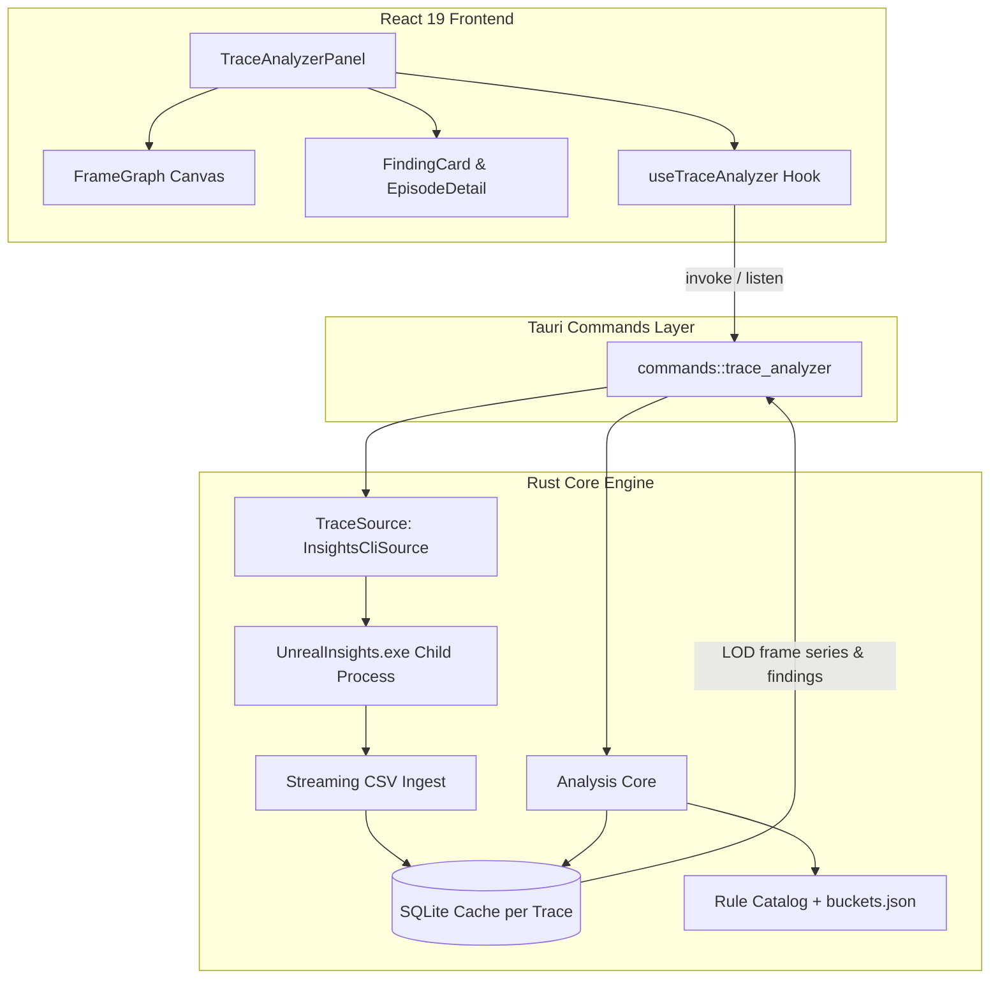

# Requirements

### Overview & Goals
The **Trace Analyzer** is a high-performance diagnostic tool for the UE Launcher (CommandHelper) ToolBox. It analyzes Unreal Engine `.utrace` performance captures headlessly using the engine's built-in `UnrealInsights.exe` export capabilities, generates a responsive **frame time graph**, and provides developers with an actionable, ranked **diagnosis report** detailing what caused hitches and slow regions, the confidence level, usual fixes, and verification steps.

### Scope
- **In Scope (MVP)**:
  - Headless execution of `UnrealInsights.exe` via response files (`.rsp`) in a two-pass workflow (Pass A: lightweight frame data; Pass B: targeted episode windows and baseline frames).
  - Streaming CSV ingestion directly into per-trace SQLite databases without loading entire multi-GB files into process memory.
  - Interactive `<canvas>` frame time graph with multi-LOD queries, budget guides (16.7 / 33.3 / 66.7 ms), hitch/slow-region indicators, and zoom/pan/range-selection controls.
  - Hitch detection (isolated spikes) and slow region detection (sustained load) with periodicity recognition.
  - Exclusive-time nesting calculation to isolate true bottlenecks on critical path threads (Game, Render, RHI, GPU).
  - Baseline comparison against local neighboring frames and global trace baselines.
  - Deterministic diagnosis engine matching against embedded rule definitions (GC, sync asset loading, shader compile, PSO creation, Blueprint tick, physics, animation, render thread bound, GPU bound, unattributed gaps, editor overhead, frame limiter).
  - Actionable finding cards with match confidence, fix likelihood ratings, quantitative evidence numbers, ordered fix steps, and verification instructions.
  - Background process cancellation, caching via BLAKE3 hashes, and seamless ToolBox integration.
  - Documentation in `docs/TRACE_ANALYZER.md`, `docs/TOOLBOX.md`, and `README.md`.
- **Out of Scope (MVP / Deferred to Phase 2/3)**:
  - Native binary `.utrace` parsing in Rust (deferred; abstracted behind `TraceSource` trait).
  - Worker thread timeline ingestion (deferred to preserve memory and execution speed).
  - Counter channel rules (memory, draw calls, actor count).
  - Bookmark and named region timeline overlays.
  - Multi-trace diffing/regression comparison.

### User Stories
- **As an Unreal Engine developer**, I want to drop a `.utrace` file onto the Trace Analyzer so that I can immediately view a frame time graph without manually opening Unreal Insights and wading through thousands of raw timing tracks.
- **As a performance engineer**, I want clear diagnostic findings explaining which scopes (e.g. `CollectGarbage`, `StaticLoadObject`, `CreateGraphicsPipelineState`) caused spikes compared to normal frames so that I know exactly what code or assets to optimize.
- **As a developer profiling in editor**, I want editor overhead (e.g. `Slate::Tick`, `Slate::DrawWindows`) clearly distinguished from packaged runtime costs so that I do not spend time optimizing non-game code.

### Functional Requirements
- **Trace Ingestion & Loading**:
  - Accept `.utrace` files via drag-and-drop or file picker.
  - Auto-detect installed Unreal Engine versions and resolve `<engine_root>/Engine/Binaries/Win64/UnrealInsights.exe`.
  - Execute Insights headlessly with complete background suppression (`CREATE_NO_WINDOW | DETACHED_PROCESS` and null stdio redirection) ensuring no command prompt or console window is ever visible to the user.
  - Execute Insights headlessly in two distinct passes:
    - **Pass A**: Fast export of thread list, timer list, and top-level frame boundaries (`GameThread`, render threads, GPU queues). Display frame time graph immediately upon Pass A completion.
    - **Pass B**: Targeted export of top hitch episodes (up to 8 merged windows) and baseline frames.
  - Normalize frame start times relative to trace start timestamp so graph viewport and episode queries align seamlessly regardless of engine uptime offset.
  - Stream CSV records directly into SQLite in batches of ~50,000 rows with WAL mode enabled.
  - Cache results per trace file using `blake3(path | size | mtime | schema_version | engine_version)` so subsequent opens are instantaneous (< 1 s).
- **Visualization & Graphing**:
  - Render frame intervals and optional Game / Render / GPU breakdown on HTML5 `<canvas>`.
  - Accurately query frame series within the valid normalized time range `[0, durationS]`.
  - Provide budget lines for 30 fps (33.3 ms), 60 fps (16.7 ms), and 120 fps (8.33 ms), with 2×/4× threshold guides.
  - Support Level of Detail (LOD) downsampling (`FrameBucket` min/max/avg series for wide zoom levels; individual `FramePoint` points when zoomed in).
  - Interactive selection: click to inspect episode/frame, shift-drag to select time range (filters findings list), mouse wheel to zoom, drag to pan.
- **Diagnosis & High-Signal Findings**:
  - Classify episodes by primary bottleneck (`game`, `render`, `rhi`, `gpu`, `idle_limited`, `unattributed`).
  - Compute exclusive time per scope by subtracting child timer intervals from parent intervals.
  - Compute timer excess against local baseline normal frames (`episode_excl_ms - baseline_median_excl_ms`) using in-memory indexed lookups for sub-second rule evaluation.
  - Map timers to buckets and execution kinds (`work`, `wait`, `idle`, `editor_only`) via embedded `buckets.json`.
  - Aggregate and deduplicate findings by root cause rule across affected episodes instead of spamming duplicate per-episode cards.
  - Enforce noise suppression thresholds (excess $\ge 2.0\text{ ms}$, share $\ge 10\%$, cap at top 4 evidence bullets per card, filter out 0% excess and sub-millisecond noise scopes).
  - Match against embedded diagnostic rules (R01–R06, R10–R15, R19, R21) and compute match confidence score ($0.0 - 1.0$) and fix likelihood (`high`, `medium`, `low`).
  - Display finding cards with prioritized evidence bullets, ordered fix suggestions with effort levels, verification guidelines, caveats, and affected episodes.
  - Display one-line summary verdict and editor capture banners where appropriate.
  - Provide "Copy report" (Markdown format) and "Open in Unreal Insights" (`-OpenTraceFile="<path>"`) actions.

### Non-Functional Requirements
- **Memory & UI Performance**: App memory footprint remains flat during ingestion of multi-GB traces. All heavy ingestion and querying runs inside `tokio::task::spawn_blocking`.
- **Cancellation & Safety**: Ingestion is cancellable within 2 seconds via process termination without leaving orphaned child processes or corrupted cache files.
- **Dark Theme Consistency**: UI adheres to existing dark palette (`bg-slate-800/30`, `border-slate-600/60`, `text-slate-300`, `bg-sky-600/60`).
- **Zero New NPM Dependencies**: Pure React 19 / TypeScript / Tailwind 4 / Canvas implementation.

# Technical Design

### Current Implementation
- **ToolBox Architecture**: `src/components/ToolBoxTab.tsx` organizes tools in a vertical navigation bar with collapsible `OutputLogPanel`. Tools requiring fixed viewport heights (`UELogAnalyzerPanel`, `IncludeModuleFinderPanel`) use `contentOverflow: 'hidden'`.
- **Backend Infrastructure**: `src-tauri` runs Tauri 2 on Windows with `rusqlite` (bundled), `tokio`, `serde`, and `windows` API integration. Subprocess execution and stream capture are handled via `stream_processor.rs` and `running_process.rs`.
- **SQLite Storage Pattern**: As demonstrated in `include_finder.rs`, indexed databases reside under `app.path().app_data_dir()`.

### Key Decisions
- **Two-Pass Headless Export**: Rather than attempting a native `.utrace` binary parser or exporting the entire multi-GB trace at event-level granularity, we run `UnrealInsights.exe` headlessly with response files (`.rsp`) in two passes (Pass A for frame metadata, Pass B for targeted episode windows). Merged time windows in Pass B prevent excessive command fragmentation.
- **Complete Background Window Suppression**: Child process execution sets `CREATE_NO_WINDOW | DETACHED_PROCESS` and null stdio handles to ensure no prompt window or console flashes on screen.
- **Normalized Trace Timeline**: All frame and event start timestamps are normalized relative to `trace_start_s` ($t = 0.0\text{ s}$), eliminating offset discrepancies between engine session timestamps and the UI graph viewport.
- **In-Memory Baseline Cache for Diagnosis**: Baseline distributions and timer names are preloaded into memory before rule evaluation, replacing nested per-timer SQL queries with fast $O(1)$ lookups and eliminating catalog matching freezes.
- **Deduplicated, High-Signal Findings**: Findings are grouped by rule ID across episodes, with noise filters suppressing sub-millisecond timer excess and capping evidence to the top 3–4 most impactful scopes.
- **`TraceSource` Trait Isolation**: Ingestion logic is isolated behind a `TraceSource` trait (`InsightsCliSource`), allowing potential native Rust parsers in future phases without altering analysis code.
- **Exclusive-Time Analysis Over Inclusive-Time**: Insights timers aggregate inclusive time across all threads, making `WaitForTasks` or top-level `Tick` appear as culprits. We calculate true exclusive time on critical path threads, filtering out `wait` and `idle` scopes before ranking.
- **Local vs Global Baseline Comparison**: Spikes are evaluated against neighboring normal frames (within ±5 s) to account for shifting gameplay loads over long play sessions.

### Architecture Diagram



### Proposed Changes

#### 1. Backend (`src-tauri`)
- Add `csv = "1"` and `blake3 = "1"` to `Cargo.toml`.
- Add `mod trace;` in `lib.rs` and create `src-tauri/src/trace/`:
  - `source.rs`: `TraceSource` trait definition.
  - `insights_cli.rs`: Locate `UnrealInsights.exe`, construct `.rsp` response files, execute headless commands with `CREATE_NO_WINDOW | DETACHED_PROCESS` and null stdio redirection, and manage process lifecycle.
  - `store.rs`: SQLite schema initialization, BLAKE3 cache key generation, episode queries, and LOD aggregation.
  - `csv_ingest.rs`: Streaming row-by-row parser with timeline normalization (`start_s -= trace_start_s`).
  - `frames.rs`: Frame interval calculation, robust statistics (median, MAD, p95, p99), hitch and slow-region episode detection, and periodicity analysis.
  - `exclusive.rs`: Interval stack algorithm for exclusive execution time calculation.
  - `buckets.rs`: Timer bucket matching and scope classification (`work`, `wait`, `idle`, `editor_only`).
  - `baseline.rs`: Consolidated Pass B window generation and local/global baseline metrics calculation.
  - `rules.rs`: In-memory baseline lookup, diagnostic rule evaluation, high-signal filtering ($\ge 2\text{ ms}$, $\ge 10\%$ share), finding deduplication across episodes, and verdict generation.
- Embedded resources in `src-tauri/resources/trace/`:
  - `buckets.json`: Timer regex to bucket and kind mappings.
  - `rules/*.json`: Seed diagnosis rules (R01–R06, R10–R15, R19, R21) with calibrated thresholds.
- Add `src-tauri/src/commands/trace_analyzer.rs` and register all commands in `commands/mod.rs` and `lib.rs`.

#### 2. Frontend (`src`)
- `src/types/traceAnalyzer.ts`: TypeScript definitions for summaries, frame series, episodes, evidence, fix suggestions, and findings.
- `src/hooks/useTraceAnalyzer.ts`: State management hook handling trace loading, engine detection, progress event subscriptions, graph LOD debouncing, and cancellation.
- `src/components/traceAnalyzer/`:
  - `FrameGraph.tsx`: High-performance `<canvas>` renderer with pan/zoom/range selection, budget guides, and hitch markers.
  - `SummaryHeader.tsx`: Overview stats, target fps selector, one-line verdict, and editor banner.
  - `FindingCard.tsx`: Ranked finding card with confidence bar, fix likelihood rating, quantitative evidence bullets, and fix recommendations.
  - `EpisodeDetail.tsx`: Breakdown of the selected episode showing bound-by thread, stacked bucket comparison vs baseline, and top excess timers.
  - `LoadingStages.tsx`: Multi-stage progress indicator during Insights export and ingestion.
- `src/components/TraceAnalyzerPanel.tsx`: Main panel integrating empty state, drag-and-drop handler, toolbar, graph, and split findings/detail view.
- Register `trace-analyzer` tool in `src/components/ToolBoxTab.tsx`.

#### 3. Documentation
- Create `docs/TRACE_ANALYZER.md` recording verified CLI options, CSV schemas, and user guide.
- Update `docs/TOOLBOX.md` and `README.md`.

### Data Models / Contracts

#### SQLite Schema
```sql
CREATE TABLE meta (key TEXT PRIMARY KEY, value TEXT);
CREATE TABLE threads (id INTEGER PRIMARY KEY, name TEXT NOT NULL, role TEXT);
CREATE TABLE timers (id INTEGER PRIMARY KEY, name TEXT NOT NULL, bucket TEXT, kind TEXT);
CREATE TABLE frames (
  idx INTEGER PRIMARY KEY,
  engine_frame INTEGER,
  start_s REAL NOT NULL,
  interval_ms REAL NOT NULL,
  game_ms REAL, render_ms REAL, gpu_ms REAL
);
CREATE INDEX idx_frames_start ON frames(start_s);
CREATE TABLE episodes (
  id INTEGER PRIMARY KEY,
  kind TEXT NOT NULL,
  start_s REAL NOT NULL, end_s REAL NOT NULL,
  frame_from INTEGER, frame_to INTEGER,
  peak_ms REAL, median_ms REAL,
  bound_by TEXT,
  periodic_group INTEGER
);
CREATE TABLE window_events (
  window_id INTEGER NOT NULL,
  thread_id INTEGER NOT NULL, timer_id INTEGER NOT NULL,
  start_s REAL NOT NULL, end_s REAL NOT NULL,
  depth INTEGER,
  excl_ms REAL NOT NULL
);
CREATE INDEX idx_we ON window_events(window_id, thread_id, timer_id);
CREATE TABLE baseline_stats (
  scope TEXT NOT NULL,
  thread_id INTEGER, timer_id INTEGER,
  median_excl_ms REAL, p95_excl_ms REAL, median_calls REAL, samples INTEGER
);
CREATE TABLE findings (
  id INTEGER PRIMARY KEY, rule_id TEXT NOT NULL,
  rank REAL NOT NULL,
  match_confidence REAL NOT NULL,
  fix_likelihood TEXT NOT NULL,
  episode_ids TEXT NOT NULL,
  payload TEXT NOT NULL
);
```

#### TypeScript Interfaces (`src/types/traceAnalyzer.ts`)
```ts
export type EpisodeKind = 'hitch' | 'slow_region';
export type BoundBy = 'game' | 'render' | 'rhi' | 'gpu' | 'idle_limited' | 'unattributed';
export type Level = 'high' | 'medium' | 'low';

export interface TraceSummary {
  traceId: string;
  path: string;
  sizeBytes: number;
  durationS: number;
  frameCount: number;
  engineVersion?: string;
  isEditorBuild: boolean;
  medianMs: number;
  p95Ms: number;
  p99Ms: number;
  targetMs: number;
  hitchCount: number;
  slowRegionCount: number;
  verdict: string;
  missingChannels: string[];
}

export interface FramePoint {
  t: number;
  frameMs: number;
  gameMs?: number;
  renderMs?: number;
  gpuMs?: number;
}

export interface FrameBucket {
  t0: number;
  t1: number;
  minMs: number;
  maxMs: number;
  avgMs: number;
  count: number;
}

export interface Episode {
  id: number;
  kind: EpisodeKind;
  startS: number;
  endS: number;
  peakMs: number;
  medianMs: number;
  boundBy: BoundBy;
  frameFrom: number;
  frameTo: number;
}

export interface Evidence {
  label: string;
  valueMs?: number;
  baselineMs?: number;
  calls?: number;
  thread?: string;
  note?: string;
}

export interface FixSuggestion {
  text: string;
  effort: Level;
  cvarsOrApis?: string[];
}

export interface Finding {
  id: number;
  ruleId: string;
  title: string;
  matchConfidence: Level;
  matchScore: number;
  fixLikelihood: Level;
  explainsMs: number;
  ofExcessMs: number;
  evidence: Evidence[];
  fixes: FixSuggestion[];
  verify: string;
  caveats: string[];
  episodeIds: number[];
  periodS?: number;
}

export type TraceStage =
  | 'locating_insights'
  | 'exporting_frames'
  | 'ingesting_frames'
  | 'detecting_episodes'
  | 'exporting_windows'
  | 'ingesting_windows'
  | 'analyzing'
  | 'done';

export interface TraceProgressPayload {
  stage: TraceStage;
  indeterminate: boolean;
  percent?: number;
  rows?: number;
  bytesRead?: number;
  bytesTotal?: number;
  elapsedMs: number;
  message?: string;
}
```

### File Structure
```
src-tauri/
├── Cargo.toml
├── resources/trace/
│   ├── buckets.json
│   └── rules/
│       ├── gc_hitch.json
│       ├── sync_load.json
│       ├── shader_compile.json
│       ├── pso_hitch.json
│       ├── bp_tick.json
│       ├── physics_cpu.json
│       ├── animation_cpu.json
│       ├── editor_overhead.json
│       ├── gpu_bound.json
│       ├── render_cpu.json
│       ├── unattributed_gap.json
│       └── frame_limiter.json
├── src/
│   ├── lib.rs
│   ├── commands/
│   │   ├── mod.rs
│   │   └── trace_analyzer.rs
│   └── trace/
│       ├── mod.rs
│       ├── source.rs
│       ├── insights_cli.rs
│       ├── store.rs
│       ├── csv_ingest.rs
│       ├── frames.rs
│       ├── exclusive.rs
│       ├── buckets.rs
│       ├── baseline.rs
│       └── rules.rs

src/
├── types/
│   └── traceAnalyzer.ts
├── hooks/
│   └── useTraceAnalyzer.ts
├── components/
│   ├── ToolBoxTab.tsx
│   ├── TraceAnalyzerPanel.tsx
│   └── traceAnalyzer/
│       ├── FrameGraph.tsx
│       ├── SummaryHeader.tsx
│       ├── FindingCard.tsx
│       ├── EpisodeDetail.tsx
│       └── LoadingStages.tsx

docs/
├── TOOLBOX.md
└── TRACE_ANALYZER.md
```

### Risks & Mitigations
- **Unreal Insights CLI Quirks & Syntax Variations**: Path spaces or version differences in command names (`ExportTimers` vs `ExporTimers`).
  *Mitigation*: Section 13 spike executes directly against UE 5.7 installation using `.rsp` response files before any UI code is written.
- **Large Trace Memory Blow-up**: Traces containing tens of millions of timing events could exhaust RAM.
  *Mitigation*: Header-driven streaming CSV ingestion directly to SQLite, bounded window export (top 15 episodes + sampled baselines, row cap 5M), and LOD downsampling on query.
- **Process Cancellation & Zombie Processes**: User closing app or pressing stop while Insights runs.
  *Mitigation*: Integrated PID tracking in `running_process.rs` with recursive child process tree termination on cancel or app shutdown.

# Testing

### Validation Approach
Verification combines backend unit/integration tests for ingestion and rule evaluation, headless verification against real engine traces (the reference sample trace), and frontend UI interaction checks.

### Key Scenarios
1. **Spike Verification (Section 13)**:
   - Verify `UnrealInsights.exe` detection under `<engine_root>/Engine/Binaries/Win64/UnrealInsights.exe`.
   - Run headless export with `.rsp` file and confirm clean exit code and CSV generation.
   - Confirm frame timer names, thread names (`GameThread`, `RHIThread`, `GPU0-Graphics0`), and exclusive time accuracy.
2. **Reference Sample Trace Validation**:
   - Ingest reference trace: `20261027_102636.utrace` (UE 5.7 editor capture).
   - Verify Pass A loads and renders graph within target time.
   - Verify isolated ~100 ms spike (around frame ~390) and sustained 20–50 ms region (frames ~780–1300) are classified as distinct episode kinds (`hitch` vs `slow_region`).
   - Verify `WaitForTasks`, `ExecuteBackgroundTask`, and `FEngineLoop_UpdateTimeAndHandleMaxTickRate` are filtered out of culprit rankings.
   - Verify `Slate::Tick` / `Slate::DrawWindows` trigger editor capture banner and are marked as editor-only costs.
   - Verify GPU-bound passes vs CPU bound stages are accurately identified.
3. **Caching & Re-analysis Performance**:
   - Re-opening cached trace returns instant summary (< 1 s) without running Insights.
   - Changing target FPS or hitch thresholds re-runs lightweight analysis in < 200 ms without re-exporting CSVs.
4. **Cancellation & Error Handling**:
   - Cancelling analysis during Pass A or Pass B terminates child processes and cleans up temporary `.rsp` / CSV files.
   - Handling missing Insights executable or trace without frame channels presents informative guidance.

### Test & Build Checks
- Backend check: `cargo check` in `src-tauri` with no warnings.
- Frontend check: `npm run lint` and `npm run build` (`tsc -b`) pass cleanly.

# Delivery Steps

### ✓ Step 1: Headless Process Window Suppression & Timeline Normalization
Eliminate prompt/console window popups and ensure frame start times are normalized relative to trace start.

- Update `src-tauri/src/trace/insights_cli.rs` with `CREATE_NO_WINDOW | DETACHED_PROCESS` creation flags and null stdio handles (`stdin(Stdio::null())`, `stdout(Stdio::null())`, `stderr(Stdio::null())`).
- Normalize frame timestamps in `src-tauri/src/trace/csv_ingest.rs` (`start_s -= trace_start_s`), guaranteeing all start times across frames, episodes, and window events begin at $t = 0.0\text{ s}$.
- Update `duration_s` and `TraceSummary` calculations in `src-tauri/src/trace/store.rs` and `src-tauri/src/commands/trace_analyzer.rs`.

### ✓ Step 2: Pass B Window Merging & In-Memory Diagnosis Engine Optimization
Resolve the 3-minute import freeze by consolidating window exports and using in-memory baseline lookups.

- Update `src-tauri/src/trace/baseline.rs` to merge nearby episode windows and consolidate baseline sampling into bounded export commands (reducing Insights command count from >100 down to <10).
- Update `src-tauri/src/trace/rules.rs` to preload `baseline_stats` and timer classifications into in-memory `HashMap` structures, replacing hundreds of thousands of individual SQLite queries with $O(1)$ lookups during rule evaluation.
- Ensure `window_events` inserts and queries use composite indexes `(window_id, timer_id)`.

### ✓ Step 3: High-Signal Findings Filtering & Deduplication
Eliminate noisy, sub-millisecond evidence and aggregate findings by rule across episodes.

- Add noise filters in `src-tauri/src/trace/rules.rs`: ignore excess $< 2.0\text{ ms}$ or $< 10\%$ share of explainable excess, and suppress negligible unattributed gaps.
- Group and deduplicate findings by `rule_id` across episodes into consolidated finding cards containing aggregate excess and affected episode IDs.
- Cap evidence bullets per finding card to top 3–4 most impactful scopes sorted by excess ms descending.
- Update seed rule templates in `src-tauri/resources/trace/rules/*.json` to ensure clean, actionable evidence wording.

### ✓ Step 4: Frame Graph Viewport & Interaction Alignment
Ensure the frame time graph renders immediately upon Pass A completion and aligns with the normalized timeline.

- Update `src/components/traceAnalyzer/FrameGraph.tsx` to handle normalized `[0, durationS]` viewport queries and responsive canvas rendering.
- Update `src/hooks/useTraceAnalyzer.ts` to trigger LOD fetch on `trace-analyzer:frames-ready` and preserve active selections.
- Verify tooltip time formatting (`Xm Y.Zs`) and budget guide rendering.

### ✓ Step 5: End-to-End Verification with Real Traces & Build Checks
Validate performance and diagnosis quality against real Unreal Engine traces.

- Test with `C:\Users\hp\Downloads\20261027_094803.utrace` and `20261027_102636.utrace` to verify fast import (< 15s), zero window popups, non-empty frame graph, and high-signal finding cards.
- Run `cargo test` and `cargo check` in `src-tauri`.
- Run `npm run lint` and `npm run build` in root.